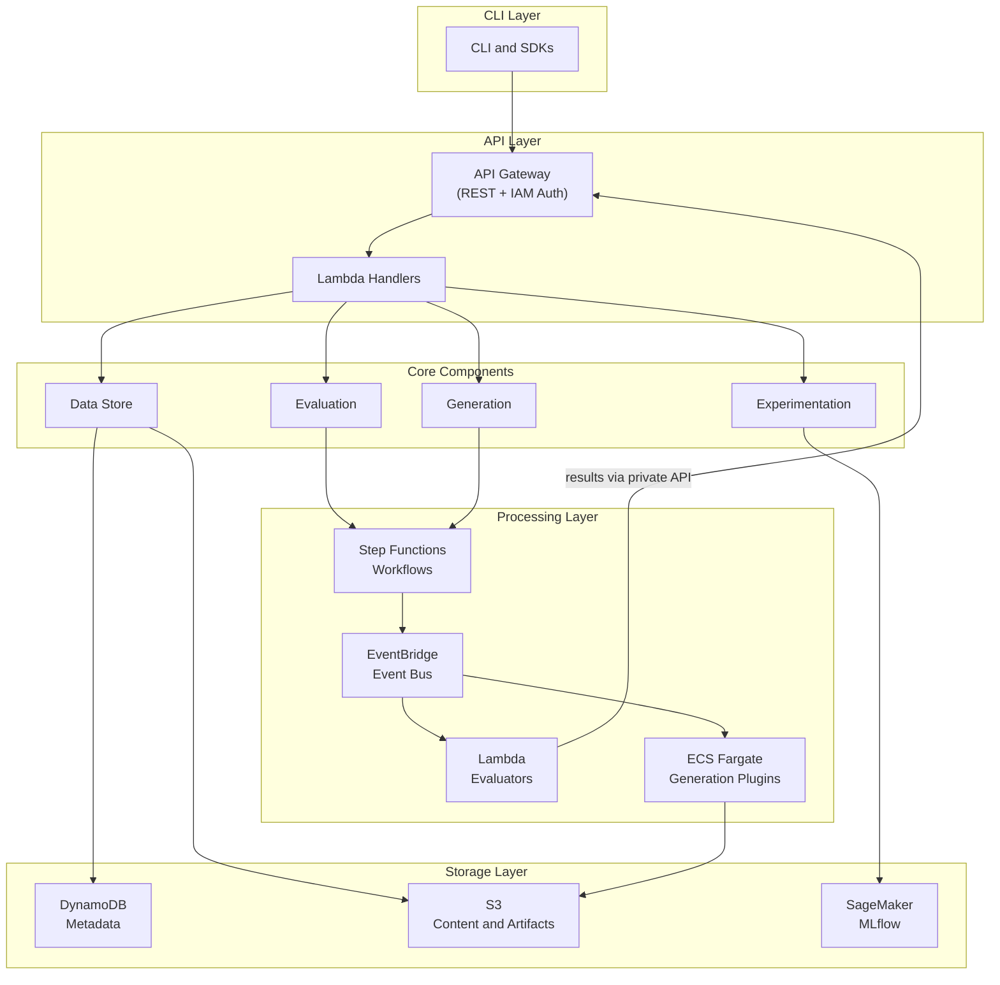
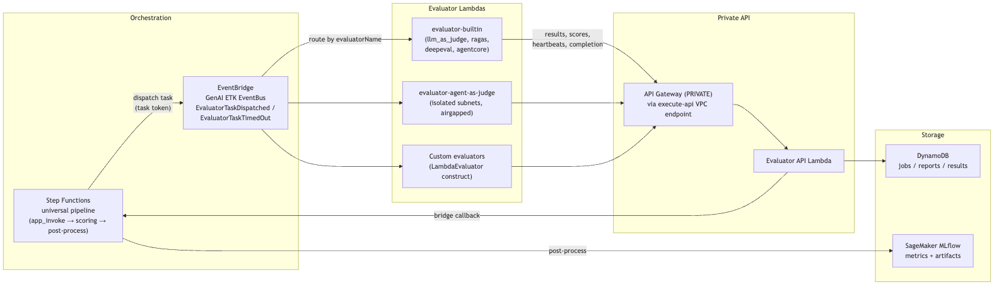
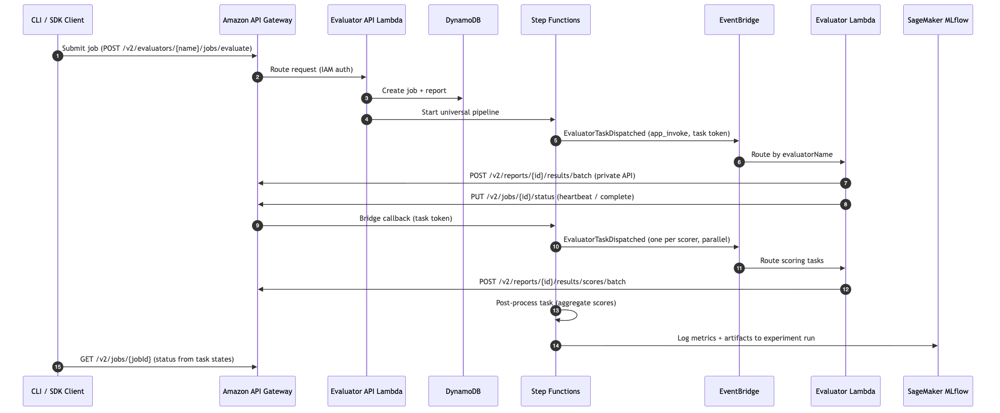
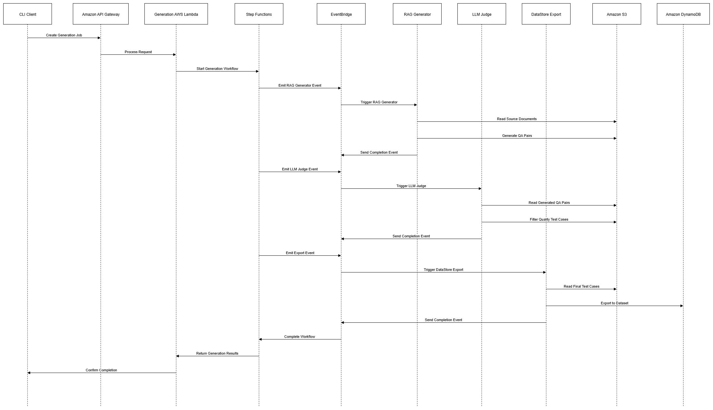
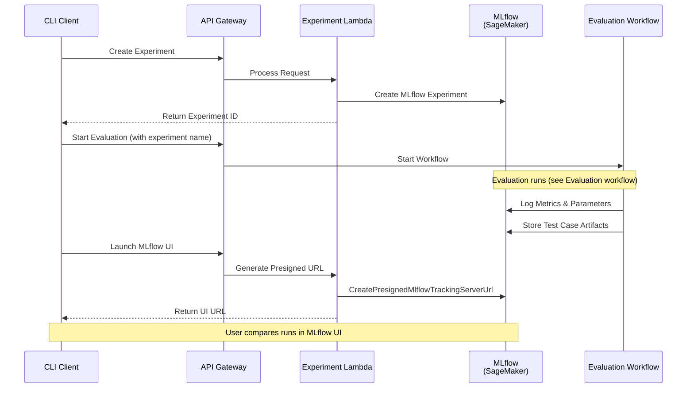
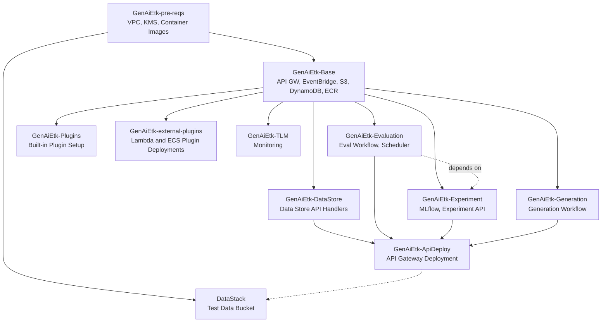
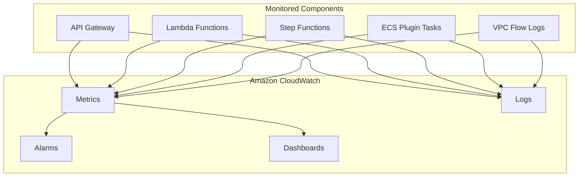

# Overview

Gen AI Evaluation Toolkit on AWS (Gen AI ETK) is a flexible, enterprise-grade, cloud-native accelerator built on AWS serverless architecture that enables comprehensive evaluation of generative AI applications — a foundation you deploy into your own AWS account, own in full source, and extend. Developed from Amazon and AWS field experience, the toolkit provides end-to-end capabilities including test case generation and version management, both metrics-based and LLM-based quality assessments, and visualization of experiment results. With its plugin-based extensible architecture, Gen AI ETK can support multiple evaluation frameworks and methodologies while offering robust experiment management for systematic comparison of different configurations and models. This integrated approach allows teams to track performance metrics across iterations and make data-driven decisions throughout the application lifecycle from discovery, to CI/CD, to continuous improvement at scale.

## Key features

- **Dataset management**: Centralized storage with versioning, metadata tracking, filtering, and test case annotation.
- **Test case generation**: Synthetic test case creation through an extensible plugin architecture, including RAG-specific QA pair generation using Amazon Bedrock.
- **Evaluation**: Quantitative metrics assessment with built-in RAG evaluation metrics, a customizable plugin framework, and scheduled execution through Amazon EventBridge.
- **Experimentation**: Systematic comparison with versioned experiment conditions, performance tracking through MLflow, and comparative analysis across models and configurations.
- **Gateway integration (optional)**: Route all LLM calls through an AI gateway for centralized cost tracking and budget enforcement, instead of calling Amazon Bedrock directly. The AI gateway referenced here is a customer-provided, third-party component — it is not an AWS service. It must be an OAuth2-fronted LLM gateway compatible with the Bedrock Converse API. See [AI gateway integration (optional)](#ai-gateway-integration-optional).

## Business problems solved

- **Quality assurance**: Identify hallucinations and factual errors, measure relevance and coherence, and help ensure consistency across varying inputs through automated testing.
- **Compliance and risk**: Document testing processes and results, standardise evaluation against benchmarks, and track performance improvements over time.
- **Continuous improvement**: Compare configurations quantitatively, identify specific weaknesses through detailed metrics, and monitor performance across versions.
- **Development integration**: Integrate evaluations into CI/CD pipelines through the CLI and SDK, with comprehensive API interfaces and experiment tracking.

## Target audiences

This Solution Guide is intended for IT infrastructure teams, DevOps engineers, and solution architects who are responsible for deploying, operating, and maintaining the toolkit. If you are looking for guidance on running evaluations and using the toolkit's features, see the User Guide.

# Architecture

Gen AI ETK uses a serverless, event-driven architecture that prioritizes modularity, extensibility, and fault tolerance.

## Architecture diagram



The architecture is organised into five functional layers, described from top to bottom.

## Architecture details

### CLI layer

A Node.js command-line interface that provides the primary user interaction point. The CLI communicates with the API layer using IAM-authenticated requests. A generated TypeScript client and Python client are also available for programmatic access.

### API layer

Two API Gateway instances expose REST endpoints consumed by the CLI and SDKs:

- **Public API** (EDGE by default): used by external callers. The endpoint URL is published to SSM Parameter Store at `/genai-etk/restApiEndpoint`.
- **Private API** (always created): accessible only from within the VPC via the `execute-api` VPC endpoint. Used by all internal Lambdas, including the Agent-as-Judge evaluator in its isolated subnets.

Both APIs share the same Lambda handlers — requests are processed identically regardless of entry point. All requests are authenticated using IAM (SigV4).

### Core components layer

Four specialized components implement the toolkit's primary capabilities:

- **Data store**: Manages datasets, test cases, and annotations with versioning. Uses DynamoDB (single-table design) for metadata and S3 for content storage.
- **Evaluation**: Coordinates metrics processing and evaluation jobs. Uses Step Functions for workflow orchestration and EventBridge for plugin coordination.
- **Generation**: Handles synthetic test case creation and LLM-based quality filtering. Uses a sequential plugin execution workflow with S3 for data exchange.
- **Experimentation**: Tracks experiment configurations and results. Integrates with Amazon SageMaker MLflow for metrics visualization and comparison.

### Storage layer

- **Amazon DynamoDB**: Metadata storage using a single-table design.
- **Amazon S3**: Content storage for datasets, evaluation results, generation artifacts, and experiment data. Separate buckets are used for each domain.
- **Amazon SageMaker MLflow**: Metrics tracking and experiment visualization.

### Processing layer

- **AWS Step Functions**: Orchestrates evaluation and generation workflows via a universal pipeline (app_invoke → scoring → post-processing).
- **Amazon EventBridge**: Routes evaluation tasks to registered evaluators by `evaluatorName`.
- **AWS Lambda**: Runs built-in evaluators (LLM-as-Judge, RAGAS, AgentCore) and custom evaluator functions. Custom evaluators can run on any compute that receives EventBridge events and calls the ETK API, but the provided `LambdaEvaluator` CDK construct targets Lambda.
- **Amazon ECS (Fargate)**: Runs generation plugins (RAG test case generator, LLM-as-Judge quality filter).

## Evaluator architecture



Evaluators are Lambda functions that perform evaluation work (app invocation, scoring, or both). ETK orchestrates them via Step Functions and EventBridge:

1. **Dispatch**: Step Functions emits an `EvaluatorTaskDispatched` event to EventBridge with a `taskToken` for callback.
2. **Routing**: EventBridge routes the event to the correct evaluator Lambda based on `evaluatorName`.
3. **Execution**: The evaluator processes test cases, writes results to DynamoDB via the ETK API, and sends heartbeat signals.
4. **Heartbeat**: Step Functions enforces a configurable heartbeat timeout (default: 300s). If no heartbeat is received, the task is marked as timed out.
5. **Completion**: The evaluator signals completion via the API, which bridges the callback to Step Functions.
6. **CONTINUE**: For large datasets, evaluators checkpoint progress and return `CONTINUE` — Step Functions re-invokes with the checkpoint to resume.

Evaluators are registered using the `LambdaEvaluator` CDK construct, which wires EventBridge routing, on-failure detection, and API permissions automatically.

### Built-in evaluators

All built-in scorers run inside a single `evaluator-builtin` Lambda (2048 MB, 15-minute timeout):

| Scorer | Name | Description |
|--------|------|-------------|
| LLM-as-Judge | `llm_as_judge` | LLM-based assessment using Bedrock. Built-in sub-scores: toxicity, tool_use, sample. Custom sub-scores via description. |
| RAGAS | `ragas` | RAG metrics: faithfulness, answer relevancy, context recall. Uses Bedrock for LLM and embeddings. |
| AgentCore | `agentcore` | Evaluates agentic systems via Bedrock AgentCore built-in evaluators (GoalSuccessRate, Correctness, etc.). |
| DeepEval | `deepeval` | Comprehensive LLM evaluation across 37 single-turn and conversational metrics (e.g. answer relevancy, faithfulness, toxicity, bias, hallucination). Uses Bedrock. See the User Guide for the full metric list. |

#### DeepEval Lambda configuration

DeepEval [enables anonymous telemetry by default](https://deepeval.com/docs/data-privacy) and writes a cache/telemetry directory at import time. The `evaluator-builtin` Lambda has a read-only filesystem, so the scorer sets two environment variables **in code, before importing DeepEval**:

- `DEEPEVAL_TELEMETRY_OPT_OUT=YES` — **disables DeepEval's built-in telemetry in ETK deployments**: no usage data is transmitted to DeepEval or any third party. (DeepEval ships with telemetry enabled; ETK turns it off unless you deliberately override this variable.)
- `DEEPEVAL_CACHE_FOLDER=/tmp/.deepeval` — redirects DeepEval's cache to Lambda's writable `/tmp`, avoiding `OSError: Read-only file system` on cold start.

Both are set unconditionally and require no deployment configuration. If you run the scorer outside Lambda (e.g. locally via the SDK), the same defaults apply unless you override the variables.

The **Agent-as-Judge** scorer runs in a dedicated `evaluator-agent-as-judge` Lambda (2048 MB, 15-minute timeout):

| Scorer | Name | Description |
|--------|------|-------------|
| Agent-as-Judge | `agent-as-judge` | Agentic evaluation: launches an OpenCode judge agent per evaluator that actively explores test case artifacts and optional S3-hosted requirement documents before producing a structured verdict. Ships with a built-in `requirements-compliance` evaluator. Runs in isolated subnets with no public-internet egress (see [Network isolation for the Agent-as-Judge evaluator](#network-isolation-for-the-agent-as-judge-evaluator)). `app_invoke` is not supported. |

**Generation plugins:**

| Plugin                       | Deployment Options              | Description                                                                                            |
| ---------------------------- | ------------------------------- | ------------------------------------------------------------------------------------------------------ |
| RAG Test Case Generator      | ECS: `generateTestCases`        | Creates question-answer pairs from source documents. ECS deployment for document processing workloads. |
| Agentic Test Case Generator  | ECS: `agenticTestCases`         | Generates test cases for AI agents using taxonomy-driven planning and optional OTEL trace extraction.  |
| LLM-as-Judge                 | ECS: `llmAsAJudge`              | Quality filtering for generated test cases.                                                            |
| DataStore Export             | StepFunction: `DatastoreExport` | Exports generated data to a dataset. Lambda deployment for lightweight export operations.              |

When multiple deployment options are available, choose based on your workload: Lambda variants offer faster cold starts and are suitable for smaller datasets, while ECS variants support larger datasets and longer processing times.

## Security architecture

Authentication uses IAM throughout: API Gateway uses SigV4, service-to-service communication uses IAM roles, and plugins receive scoped IAM task roles. All data is encrypted at rest (S3, DynamoDB, CloudWatch Logs) with optional customer-managed KMS keys. Plugins run in VPC-isolated ECS tasks with security groups that deny inbound traffic. The Agent-as-Judge evaluator additionally runs in subnets with no internet route, reaching AWS services exclusively through VPC endpoints — see [Network isolation for the Agent-as-Judge evaluator](#network-isolation-for-the-agent-as-judge-evaluator) and the rest of the [Security](#security-architecture) section for full details.

When the optional AI gateway integration is enabled, evaluator and plugin LLM calls authenticate to the gateway with short-lived **OAuth2 Bearer tokens** (client-credentials flow) instead of direct Amazon Bedrock SigV4. The OAuth2 client secret is stored in AWS Secrets Manager and read at runtime by the scoped task roles; all gateway traffic is HTTPS. See [AI gateway integration (optional)](#ai-gateway-integration-optional).

# AWS services in this solution

| AWS service                                                                            | Description                                                                                                                                                                                                                 |
| -------------------------------------------------------------------------------------- | --------------------------------------------------------------------------------------------------------------------------------------------------------------------------------------------------------------------------- |
| [AWS Lambda](https://aws.amazon.com/lambda/)                                           | **Core.** Runs API handlers for all CRUD operations across data store, evaluation, experimentation, and generation. Also runs serverless evaluation and generation plugins with code-based and container-based deployments. |
| [AWS Step Functions](https://aws.amazon.com/step-functions/)                           | **Core.** Orchestrates evaluation and generation workflows, coordinating plugin execution and result aggregation.                                                                                                           |
| [Amazon ECS on Fargate](https://aws.amazon.com/fargate/)                               | **Core.** Runs containerized evaluation and generation plugins. Complementary to Lambda for plugins requiring high memory (>10GB) or long execution times (>15 minutes). Both Lambda and ECS plugins scale automatically.   |
| [Amazon DynamoDB](https://aws.amazon.com/dynamodb/)                                    | **Core.** Stores metadata for datasets, test cases, annotations, and evaluation configurations using a single-table design.                                                                                                 |
| [Amazon S3](https://aws.amazon.com/s3/)                                                | **Core.** Stores dataset content, evaluation results, generation artifacts, experiment data, and plugin container images.                                                                                                   |
| [Amazon SageMaker MLflow](https://docs.aws.amazon.com/sagemaker/latest/dg/mlflow.html) | **Core.** Provides experiment tracking, metrics logging, and visualization through a managed MLflow tracking server.                                                                                                        |
| [Amazon API Gateway](https://aws.amazon.com/api-gateway/)                              | **Core.** Exposes REST API endpoints with IAM authentication for CLI and SDK access.                                                                                                                                        |
| [Amazon EventBridge](https://aws.amazon.com/eventbridge/)                              | **Core.** Enables event-driven communication between workflows and plugins, and supports scheduled evaluations.                                                                                                             |
| [Amazon SQS](https://aws.amazon.com/sqs/)                                              | **Supporting.** Provides reliable message queuing for asynchronous operations such as dataset versioning.                                                                                                                   |
| [AWS IAM](https://aws.amazon.com/iam/)                                                 | **Supporting.** Manages authentication and authorization with least-privilege roles for all components.                                                                                                                     |
| [AWS KMS](https://aws.amazon.com/kms/)                                                 | **Supporting.** Provides optional customer-managed encryption keys for S3, DynamoDB, and CloudWatch Logs.                                                                                                                   |
| [Amazon CloudWatch](https://aws.amazon.com/cloudwatch/)                                | **Supporting.** Collects logs, metrics, and alarms for operational monitoring across all components.                                                                                                                        |
| [Amazon Bedrock](https://aws.amazon.com/bedrock/)                                      | **Supporting.** Provides foundation model access for LLM-based evaluation and test case generation plugins.                                                                                                                 |
| [Amazon ECR](https://aws.amazon.com/ecr/)                                              | **Supporting.** Stores container images for evaluation and generation plugins.                                                                                                                                              |

# How Gen AI Evaluation Toolkit works

This section describes the core components and workflows in detail.

## Core components

### Data store

Manages datasets, test cases, and annotations.

- Datasets are versioned. Creating a version takes a snapshot of the current test cases.
- Test cases contain an input, optional expected output, optional context (for RAG), optional conversation history, and arbitrary metadata.
- Annotation schemas define structured labels that can be applied to test cases and dataset versions.
- DynamoDB stores metadata; S3 stores content with version-specific prefixes.
- Dataset versioning operations are processed asynchronously through SQS.

### Evaluation

Assesses generative AI application performance through configurable scorers.

- An evaluation job specifies the target evaluator, the test data source (a versioned dataset reference or inline test cases), which scorers to run with their parameters, and an optional app-invocation configuration. Jobs are submitted through the v2 API (`POST /v2/evaluators/{evaluatorName}/jobs/evaluate`, `/score`, or `/invoke`).
- Submitting a job starts the universal Step Functions pipeline: an optional app-invocation (primary) task, then parallel scoring tasks (one per scorer), then a post-processing task that aggregates scores and logs metrics to an experiment.
- Each task is dispatched to its evaluator as an `EvaluatorTaskDispatched` event on EventBridge; the evaluator writes results and scores back through the private ETK API and signals completion, which resumes the Step Functions callback.
- Evaluations can be scheduled using EventBridge Scheduler through the job scheduler API (`/evaluation-schedulers`).
- Results are stored in DynamoDB as reports (one per job) containing per-test-case results and per-scorer scores, retrievable through the `/v2/reports` API.

### Generation

Creates synthetic test cases for evaluation.

- A generation configuration specifies source documents (in S3), the generation plugins to run, and their parameters.
- The generation workflow executes plugins sequentially: first the RAG generator creates QA pairs from documents, then the LLM-as-Judge filters for quality, and finally the DataStore Export plugin writes results to a data store.
- Plugins exchange data through S3, with each plugin reading the previous plugin's output.

### Experimentation

Tracks configurations and results for systematic comparison.

- An experiment groups related evaluation runs. Each evaluation run is logged as an MLflow run under the experiment.
- Experiment configurations capture the parameters used for each run, enabling reproducibility.
- MLflow tracks metrics (evaluation scores), parameters (configuration), and artifacts (per-test-case results) for each run.
- The MLflow UI (accessible through the CLI) provides visualization and comparison of runs.

## Workflows

### Evaluation workflow



1. User submits an evaluation job through the CLI, SDK, or API (`POST /v2/evaluators/{evaluatorName}/jobs/evaluate`, `/score`, or `/invoke`), specifying the test data source (dataset reference or inline test cases), scorers, and an optional experiment name.
2. The API handler creates the job and its report in DynamoDB and starts the universal Step Functions pipeline (app_invoke → parallel scoring → post-process).
3. If the job includes app invocation, the pipeline dispatches the primary task as an `EvaluatorTaskDispatched` event to EventBridge (with a Step Functions task token) and waits for the callback. The evaluator invokes the application under test and records per-test-case results through the private ETK API (`POST /v2/reports/{reportId}/results/batch`).
4. Scoring tasks run in parallel — one `EvaluatorTaskDispatched` event per scorer, routed by EventBridge to the evaluator registered for it. Each evaluator scores the results and writes scores back via `POST /v2/reports/{reportId}/results/scores/batch`.
5. While processing, evaluators report progress through `PUT /v2/jobs/{jobId}/status`, which bridges heartbeats to Step Functions. If no heartbeat arrives within the configured interval (default 300s), the pipeline emits an `EvaluatorTaskTimedOut` event and marks the task failed. For large datasets, evaluators checkpoint and return `CONTINUE`, and the pipeline re-dispatches the task to resume from the checkpoint.
6. The post-processing task aggregates scores across the report and logs metrics to the MLflow experiment run.
7. The job's overall status (SUCCESS, PARTIAL_FAILURE, or FAILURE) is computed from the individual task states and is available via `GET /v2/jobs/{jobId}`.

**Local execution.** Evaluation does not require the deployed orchestration path. With the Evaluator SDK, `Evaluator(..., local_only=True)` runs app invocation and scorers entirely in-process — no deployed ETK instance and no API calls — which is the standard path for developing and iterating on custom evaluators. Constructing the `Evaluator` with an `api_endpoint` instead runs the evaluation locally while persisting the report, results, and scores to a deployed ETK API: the submitted job carries `processLocally=true`, which suppresses the Step Functions dispatch so only post-processing runs server-side. Within a call, tasks either run in-process (the default) or are routed to deployed evaluator workers by setting `evaluatorName` on the scorer or app config — see the User Guide for the routing rules.

### Generation workflow



1. User starts a generation job through the CLI or API, providing a generation configuration.
2. The API handler starts a Step Functions execution.
3. Plugins execute sequentially: RAG Generator → LLM-as-Judge → DataStore Export.
4. Each plugin reads its input from S3 (source documents or previous plugin output), processes it, and writes output to S3.
5. The DataStore Export plugin writes the final filtered test cases to a dataset.

### Experimentation workflow



1. User creates an experiment and defines evaluation configurations.
2. Evaluation runs are associated with the experiment. Each run is logged as an MLflow run.
3. MLflow captures metrics, parameters, and test case result artifacts for each run.
4. Users compare results across runs using the MLflow UI.

## Plugin communication

Evaluators and generation plugins communicate through EventBridge, but use different contracts.

**Evaluation (v2)** — the universal pipeline dispatches tasks and detects timeouts with these detail types (source `GenAiEvaluationToolkit`):

| Event                    | Detail type                                  | Direction                                     |
| ------------------------ | -------------------------------------------- | --------------------------------------------- |
| Evaluator task dispatch  | `EvaluatorTaskDispatched`                    | Step Functions pipeline → Evaluator           |
| Evaluator task timeout   | `EvaluatorTaskTimedOut`                      | Step Functions pipeline → Internal handler    |
| Evaluator crash/OOM      | `Lambda Function Invocation Result - Failure` | Lambda on-failure destination → Internal handler |

Each `EvaluatorTaskDispatched` event carries a Step Functions `taskToken`. Evaluators do not respond with events — they call back through the private ETK API (`PUT /v2/jobs/{jobId}/status`), which bridges heartbeats, `CONTINUE` checkpoints, completion, and failure to Step Functions.

**Generation (v1 plugin contract)** — generation plugins still use the event-based trigger/done contract:

| Event                     | Detail type                            | Direction                          |
| ------------------------- | -------------------------------------- | ---------------------------------- |
| Generation done           | `genAiEtkGenerationDoneEvent`          | Workflow → EventBridge subscribers |
| Generation plugin trigger | `genAiEtkGenerationPluginTriggerEvent` | Workflow → Plugin                  |
| Generation plugin done    | `genAiEtkGenerationPluginDoneEvent`    | Plugin → Workflow                  |

Generation plugin responses use a task token mechanism for Step Functions callback integration. Each response includes a `taskToken` and one of three statuses:

- `success`: Plugin completed. Includes optional output.
- `error`: Plugin failed. Includes error type and cause.
- `inProgress`: Plugin is still running. Includes progress percentage.

## Data models

### Test case

```json
{
  "id": "tc-456",
  "datasetId": "dataset-123",
  "input": "What is the capital of France?",
  "expected": "Paris is the capital of France.",
  "context": ["Paris is the capital and most populous city of France."],
  "metadata": {
    "category": "geography",
    "difficulty": "easy"
  }
}
```

### Test result

Each evaluated test case produces a `TestResult` in the job's report. It carries the test-case core (`input`, `expected`, `context`, `metadata`), the execution artifacts (`output`, `appMetrics`, `error`), and a `scores` map keyed by scorer name:

```json
{
  "resultId": "result-789",
  "reportId": "report-123",
  "testcaseId": "tc-456",
  "input": "What is the capital of France?",
  "expected": "Paris is the capital of France.",
  "output": { "text": "Paris is the capital of France." },
  "appMetrics": { "latencyMs": 812, "inputTokens": 42, "outputTokens": 11 },
  "scores": {
    "ragas": {
      "value": 0.95,
      "reason": "Answer is fully supported by the retrieved context.",
      "scoredAt": "2026-07-01T12:00:00Z"
    },
    "llm_as_judge": {
      "value": 0.87,
      "reason": "Response is accurate and relevant.",
      "scoredAt": "2026-07-01T12:00:05Z"
    }
  },
  "createdAt": "2026-07-01T11:59:30Z",
  "updatedAt": "2026-07-01T12:00:05Z"
}
```

Each entry in `scores` is a `ScoreOutput` with `value` (typically 0–1), a human-readable `reason`, an optional `error` if scoring failed, and an optional structured `context` detail produced by the scorer.

# Plan your deployment

## Cost

You are responsible for the cost of the AWS services used while running this solution. Cost estimates below are approximate and may vary based on configuration, usage patterns, your AWS Region, and AWS pricing changes; see the pricing page for each AWS service for current rates. The primary cost drivers are:

- **MLflow tracking server**: Approximately $500/month (runs continuously on a SageMaker managed instance).
- **Amazon Bedrock API calls**: Varies by model and usage volume. This is typically the largest variable cost.
- **AWS Lambda, Step Functions, API Gateway**: Pay-per-use; costs scale with evaluation volume. Built-in evaluators (LLM-as-Judge, RAGAS, AgentCore, DeepEval, Agent-as-Judge) run on Lambda.
- **Amazon S3 and DynamoDB**: Storage costs scale with dataset size and evaluation history.
- **ECS Fargate**: Pay-per-use for generation plugin execution time (test case generation and quality filtering). Custom plugins may use alternative compute.

We recommend creating a [budget](https://docs.aws.amazon.com/cost-management/latest/userguide/budgets-create.html) through [AWS Cost Explorer](https://aws.amazon.com/aws-cost-management/aws-cost-explorer/) to help manage costs. For full pricing details, see the pricing page for each AWS service listed in the [AWS services in this solution](#aws-services-in-this-solution) section.

## Prerequisites

Two deployment paths are supported (CDK and Terraform). The lists below are split so you can skip the path you won't use.

### Common (both CDK and Terraform)

- An AWS account with appropriate permissions for the chosen IaC tool.
- AWS credentials exported into your shell (or configured through a profile).
- Docker engine installed and running (or `finch` / `podman` / `colima` with a `docker` shim on PATH).
- `mise` installed (`brew install mise` or see [mise: getting started](https://mise.jdx.dev/getting-started.html)). Then run `mise install` to install the required tooling (Node.js, Python, Gradle, Terraform, and so on).
- Amazon Bedrock model access enabled in your target region for the models used by the plugins. See [Amazon Bedrock model access](#amazon-bedrock-model-access) for the full list of required models.

### CDK-specific

- AWS CDK CLI (provided by `mise install`).
- One-time `cdk bootstrap` against the target account/region.

### Terraform-specific

- Terraform >= 1.6 and AWS provider >= 5.x (both pinned by `mise install`). Terraform manages infrastructure state in a remote backend — unlike CDK which delegates state to CloudFormation — so a one-time account setup is required.
- AWS CLI v2 (`aws sts get-caller-identity` should resolve against the target account).
- One-time **bootstrap** of the AWS account: creates the remote-state S3 bucket, DynamoDB lock table, plugin ECR repositories, and SSM image-tag parameter. See `packages/terraform-deployment/README.md` and the Terraform deploy steps below.

### CLI and SDK distribution

The CLI and generated SDKs are not published to public registries. When planning your deployment, consider how you will distribute these to end users. Options include:

- Providing the built npm tarball (produced by `nx build cli`) to users for local installation.
- Hosting the package on a private npm registry.
- Giving users access to the source repository so they can build and link the CLI locally.

See the [User Guide](../user_guide/Gen-AI-ETK-UserGuide.md#install-the-cli) for end-user CLI installation instructions.

## AI gateway integration (optional)

By default, evaluator and generation plugins call Amazon Bedrock directly using IAM (SigV4). You can optionally route all LLM calls through an AI gateway — an OAuth2-fronted LLM gateway (Bedrock Converse-compatible) — instead, for centralized cost tracking and budget enforcement across teams. The AI gateway is a customer-provided, third-party component; it is not an AWS service, and this solution does not include one.

When enabled (by providing `gatewayConfig` at deploy time):

- LLM calls are sent to the gateway endpoint instead of Bedrock and authenticate with an **OAuth2 Bearer token** (client-credentials flow) rather than direct Bedrock SigV4.
- The OAuth2 client secret is stored in **AWS Secrets Manager**; the evaluator and plugin task roles are granted `secretsmanager:GetSecretValue` on that secret and read it at runtime to mint short-lived tokens.
- Tokens are cached and refreshed automatically, and all gateway traffic is HTTPS.
- The integration is fully opt-in and backward compatible — with no `gatewayConfig`, plugins call Bedrock directly as before, with no IAM or behavioral changes.

Configuration (gateway endpoint, OAuth2 token endpoint, client ID, client-secret ARN, and model ID) is a deploy-time concern set on the CDK construct. See the CDK package README (`packages/cdk/README.md`) for the full prop reference and prerequisites (AI gateway deployed, OAuth2 client registered, and the Secrets Manager secret created).

## Supported AWS Regions

Gen AI ETK can be deployed in any AWS Region that supports all required services. The primary constraint is Amazon Bedrock availability, as the evaluation and generation plugins depend on foundation model access.

For current Bedrock region availability, see [Model support by AWS Region in Amazon Bedrock](https://docs.aws.amazon.com/bedrock/latest/userguide/models-regions.html). For general AWS service availability, see the [AWS Regional Services List](https://aws.amazon.com/about-aws/global-infrastructure/regional-product-services/).

### Cross-region model access

The IAM roles created by the solution allow Bedrock calls to any region, enabling cross-region inference when a model is not available in the deployment region. Cross-region calls incur additional latency and data transfer costs. To restrict cross-region access, use [AWS Organizations Service Control Policies (SCPs)](https://docs.aws.amazon.com/organizations/latest/userguide/orgs_manage_policies_scps.html).

## Quotas

Service quotas, also referred to as limits, are the maximum number of service resources or operations for your AWS account. The following quotas are most likely to affect Gen AI ETK deployments:

| Service        | Quota                             | Default            | Adjustable | Impact                           |
| -------------- | --------------------------------- | ------------------ | ---------- | -------------------------------- |
| AWS Lambda     | Concurrent executions             | 1,000 per region   | Yes        | Limits parallel evaluation jobs  |
| Step Functions | State transitions per second      | 2,000 per account  | Yes        | Affects workflow execution speed |
| Amazon Bedrock | API requests per minute           | Varies by model    | Yes        | Limits evaluation throughput     |
| API Gateway    | Requests per second               | 10,000 per account | Yes        | API call throttling              |
| EventBridge    | PutEvents transactions per second | 10,000             | Yes        | Rate of plugin event processing  |
| EventBridge    | Event size                        | 256 KB             | No         | Plugin coordination data volume  |
| ECS            | Tasks per service                 | 1,000              | No         | Plugin execution capacity        |
| SageMaker      | MLflow tracking servers           | Varies by region   | Yes        | Experiment tracking              |

Gen AI ETK does not impose additional limits beyond those of the underlying AWS services. For the most current information, see the [AWS Service Quotas console](https://console.aws.amazon.com/servicequotas/). For more information, see [AWS service quotas](https://docs.aws.amazon.com/general/latest/gr/aws_service_limits.html).

## Amazon Bedrock model access

The following scorers and generation plugins require Amazon Bedrock model access. Ensure the required models are enabled in your deployment region before using them. Customers can configure alternative models through the scorer parameters or plugin configuration — see the [User Guide](../user_guide/Gen-AI-ETK-UserGuide.md) for details.

| Scorer / plugin                               | Purpose                                   | Default model(s)                                                             | Configurable                          |
| --------------------------------------------- | ----------------------------------------- | ---------------------------------------------------------------------------- | ------------------------------------- |
| RAGAS (`ragas`)                               | RAG evaluation metrics                    | `amazon.nova-micro-v1:0` (LLM), `amazon.titan-embed-text-v2:0` (embeddings)  | Yes (`model_id`, `embeddings_id`)     |
| LLM-as-Judge (`llm_as_judge`)                 | LLM-based evaluation                      | `global.amazon.nova-2-lite-v1:0`                                             | Yes (`model_id`)                      |
| DeepEval (`deepeval`)                         | LLM evaluation metrics (37 metrics)       | `us.amazon.nova-lite-v1:0`                                                   | Yes (`model_id`)                      |
| Agent-as-Judge (`agent-as-judge`)             | Agentic judge evaluation                  | `global.anthropic.claude-sonnet-4-6`                                         | Yes (`agentModel`)                    |
| RAG Test Case Generator (`generateTestCases`) | Test case generation from documents       | `anthropic.claude-haiku-4-5-20251001-v1:0`                                   | Yes (via plugin configuration)        |
| LLM-as-Judge Gen (`llmAsAJudge`)              | Quality filtering of generated test cases | `anthropic.claude-haiku-4-5-20251001-v1:0`                                   | Yes (via plugin configuration)        |

### Amazon Bedrock AgentCore access

The AgentCore scorer (`agentcore`) uses the Amazon Bedrock AgentCore Evaluations API rather than direct model invocation, and that API is available in a limited set of regions. Regional availability is subject to change — consult the [official AWS documentation](https://docs.aws.amazon.com/bedrock-agentcore/latest/devguide/agentcore-regions.html) for the latest supported regions. The scorer's `region` parameter allows cross-region API calls, so the toolkit does not need to be deployed in a supported region.

To check which models are available in your account, use:

```bash
aws bedrock list-foundation-models --query "modelSummaries[].modelId"
```

To request model access, see [Manage access to Amazon Bedrock foundation models](https://docs.aws.amazon.com/bedrock/latest/userguide/model-access.html).

# Security

When you build systems on AWS infrastructure, security responsibilities are shared between you and AWS. This [shared responsibility model](https://aws.amazon.com/compliance/shared-responsibility-model/) reduces your operational burden because AWS operates, manages, and controls the components including the host operating system, the virtualization layer, and the physical security of the facilities in which the services operate. For more information about AWS security, visit [AWS Cloud Security](https://aws.amazon.com/security/).

As a customer, you are responsible for "security in the cloud" — this includes configuring the toolkit securely according to your own security requirements, managing access to the AWS account hosting the solution, and monitoring the operating environment. The guidance in this section is intended to help you do this.

## IAM roles

The solution creates least-privilege IAM roles for each component:

- **Lambda function roles**: Scoped to the specific DynamoDB, S3, and EventBridge resources each function needs.
- **Evaluation workflow role**: Grants the Step Functions state machine access to invoke plugins, read/write the evaluation S3 bucket, and log to MLflow.
- **Generation workflow role**: Grants the Step Functions state machine access to invoke generation plugins and read/write the generation S3 bucket.
- **Plugin task roles**: Each ECS plugin task and Lambda plugin receives a role scoped to its specific S3 bucket prefix and EventBridge permissions. The `evaluator-builtin` Lambda — which hosts the RAGAS, LLM-as-Judge, and DeepEval scorers — receives `bedrock:InvokeModel` for the Bedrock models those scorers use (configurable per scorer via `model_id`/`modelId`). The Agent-as-Judge Lambda additionally receives `bedrock:InvokeModel` on all foundation models and inference profiles (required for the judge agent), and read access to the `evaluation/agent-as-judge/*` prefix of the data bucket (for artifacts and requirement documents). The AgentCore Evaluations Lambda additionally receives `bedrock-agentcore:Evaluate`, `bedrock-agentcore:ListEvaluators`, `bedrock-agentcore:GetEvaluator`, `bedrock-agentcore:CreateEvaluator`, and `bedrock-agentcore:UpdateEvaluator` permissions scoped to the deployment account. These permissions are required for inline custom evaluator definitions (get-or-create with automatic update on drift).

### Bedrock access patterns

Generation plugins use different Bedrock API access patterns based on their workload characteristics:

| Access Pattern | Plugins | API | Description |
|----------------|---------|-----|-------------|
| **Real-time Converse** | Agentic Test Case Generator | `bedrock:InvokeModel` | Direct synchronous calls to the Bedrock Converse API. Lower latency, pay-per-request pricing. Used for interactive test case generation with retry logic. |
| **Batch Inference** | RAG Test Case Generator, LLM-as-Judge (Generation) | `bedrock:CreateModelInvocationJob` | Asynchronous batch processing via Bedrock Batch API. Higher throughput for large datasets, reduced per-token cost. Requires a separate IAM role for Bedrock to access S3. |

The Agentic plugin uses real-time Converse API because it requires iterative LLM calls with retry logic for JSON parsing and validation. Batch inference is better suited for the RAG and LLM-as-Judge plugins which process large document sets in a single pass.
- **MLflow tracking server role**: Access to the experiment S3 bucket and SageMaker resources.
- **EventBridge scheduler role**: Permission to start Step Functions executions for scheduled evaluations.

## Access control

The Gen AI ETK API Gateway uses [IAM authentication](https://docs.aws.amazon.com/apigateway/latest/developerguide/permissions.html) (`AWS_IAM`) on every route. Callers sign requests with [Signature Version 4](https://docs.aws.amazon.com/IAM/latest/UserGuide/reference_aws-signing.html) using the credentials of an IAM principal (a user, role, or federated identity), and API Gateway evaluates `execute-api:Invoke` against that principal's IAM policies before forwarding the request to the backend. The toolkit does not perform any additional in-line authorization on top of API Gateway, so the IAM policies you attach to your callers are the access control mechanism.

This section explains how to map the operations exposed by ETK onto IAM policies, gives example policies for three common personas (admin, evaluator, viewer), and describes setup and audit considerations. User-level identity features such as fine-grained per-user resource ownership require Cognito or Lambda Authorizer integration, which is not currently supported and not covered here.

### Resource ARN format

API Gateway represents each route as an `execute-api` resource ARN of the form:

```
arn:<PARTITION>:execute-api:<REGION>:<ACCOUNT-ID>:<API-ID>/<STAGE>/<METHOD>/<PATH>
```

Where:

- `<PARTITION>` is the AWS partition for your deployment region. ETK is currently deployed and validated only in commercial AWS regions, so use `aws`. The placeholder is kept in the example ARNs because IAM policies require the partition field.
- `<API-ID>` is the REST API ID (for example `abc123def4`). After deployment the **public** API endpoint URL is published to AWS Systems Manager Parameter Store at `/genai-etk/restApiEndpoint` (the host portion of that URL is `<API-ID>.execute-api.<REGION>.amazonaws.com`); you can also find both API IDs in the API Gateway console. If `publicEndpointType` is `DISABLED`, no SSM parameter is created — use the private API URL directly from the CloudFormation stack outputs.
- `<STAGE>` is the deployed stage name. The toolkit deploys a single API stage named `prod`. Use `*` to match every stage if you want a forward-compatible policy.
- `<METHOD>` is the HTTP verb (`GET`, `POST`, `PUT`, `PATCH`, `DELETE`) or `*` for all verbs.
- `<PATH>` is the route path **without** a leading slash, for example `datasets`, `datasets/*`, `v2/jobs/*/status`. Note that `*` in an `execute-api` resource ARN matches any sequence of characters, including `/` — it is not limited to a single path segment. For example, `datasets/*` matches `datasets/abc`, `datasets/abc/versions/1`, and `datasets/abc/versions/1/testcases/foo`. Use the most specific path you can.

For example, to allow read-only access to all datasets and their versions on a stage named `prod`:

```
arn:aws:execute-api:us-east-1:123456789012:abc123def4/prod/GET/datasets
arn:aws:execute-api:us-east-1:123456789012:abc123def4/prod/GET/datasets/*
```

See [Control access to a REST API using IAM permissions](https://docs.aws.amazon.com/apigateway/latest/developerguide/permissions.html) for the full reference.

### API operation reference

The following table groups every ETK operation by capability. Use it to compose IAM policies tailored to your personas.

| Capability                                | Operations (method + path) |
| ----------------------------------------- | -------------------------- |
| List/read datasets and test cases         | `GET /datasets`, `GET /datasets/{datasetId}`, `GET /datasets/{datasetId}/versions/{version}`, `GET /datasets/{datasetId}/versions/{version}/testcases/{testCaseId}`, `POST /datasets/{datasetId}/versions/list`, `POST /datasets/{datasetId}/versions/{version}/testcases/list` |
| Manage datasets and test cases            | `POST /datasets`, `POST /datasets/{datasetId}/testcases`, `POST /datasets/{datasetId}/versions`, `POST /datasets/{datasetId}/restore`, `DELETE /datasets/{datasetId}`, `DELETE /datasets/{datasetId}/testcases/{testCaseId}` |
| Read annotations and schemas              | `GET /annotations/schemas`, `GET /annotations/schemas/{annotationName}` |
| Manage annotations and schemas            | `POST /annotations/schemas`, `PUT /annotations/schemas/{annotationName}/archive`, `PUT /datasets/{datasetId}/testcases/{testCaseId}/annotations`, `PUT /datasets/{datasetId}/versions/{version}/annotations`, `DELETE /datasets/{datasetId}/testcases/{testCaseId}/annotations/{annotationName}`, `DELETE /datasets/{datasetId}/versions/{version}/annotations/{annotationName}` |
| Submit evaluation jobs                    | `POST /v2/evaluators/{evaluatorName}/jobs/evaluate`, `POST /v2/evaluators/{evaluatorName}/jobs/score`, `POST /v2/evaluators/{evaluatorName}/jobs/invoke` |
| List/read evaluation jobs                 | `GET /v2/jobs`, `GET /v2/jobs/{jobId}` |
| Update evaluation job status              | `PUT /v2/jobs/{jobId}/status` — used by evaluator workers (heartbeats, checkpoints, completion) and by the SDK when running locally with API persistence |
| List/read reports and results             | `GET /v2/reports`, `GET /v2/reports/{reportId}`, `GET /v2/reports/{reportId}/results`, `GET /v2/reports/{reportId}/results/{resultId}` |
| Manage reports                            | `POST /v2/reports`, `DELETE /v2/reports/{reportId}` |
| Write results and scores                  | `POST /v2/reports/{reportId}/results/batch`, `POST /v2/reports/{reportId}/results/scores/batch`, `POST /v2/reports/{reportId}/results/delete/batch` |
| List/read evaluation schedulers           | `GET /evaluation-schedulers`, `GET /evaluation-schedulers/{name}` |
| Manage evaluation schedulers              | `POST /evaluation-schedulers`, `PATCH /evaluation-schedulers/{name}`, `DELETE /evaluation-schedulers/{name}` |
| List/read generation jobs                 | `GET /generation-jobs`, `GET /generation-jobs/{id}` |
| Run and manage generation jobs            | `POST /generation-jobs`, `POST /generation-jobs/{id}/stop` |
| List/read experiments and configurations  | `GET /experiments/{name}`, `GET /configurations/{name}`, `POST /experiments/list`, `POST /experiments/{name}/outputs`, `POST /configurations/list` |
| Manage experiments and configurations     | `POST /experiments`, `PATCH /experiments/{name}`, `DELETE /experiments/{name}`, `POST /configurations`, `PUT /configurations` |

> **Note**: There is no stop operation for v2 evaluation jobs. A running job either completes, fails, or times out via the heartbeat mechanism. Generation jobs do have a stop operation (`POST /generation-jobs/{id}/stop`).

### Example IAM policies

The examples below assume the placeholders `<PARTITION>` (`aws`), `<REGION>`, `<ACCOUNT-ID>`, `<API-ID>`, and `<STAGE>` (always `prod` for ETK). Replace them with your deployment's values.

#### Admin

Full access to every operation. Suitable for platform owners and operators who need to deploy datasets, manage schedulers, and respond to incidents.

```json
{
  "Version": "2012-10-17",
  "Statement": [
    {
      "Sid": "EtkAdminFullAccess",
      "Effect": "Allow",
      "Action": "execute-api:Invoke",
      "Resource": "arn:<PARTITION>:execute-api:<REGION>:<ACCOUNT-ID>:<API-ID>/<STAGE>/*"
    }
  ]
}
```

#### Evaluator

Read everything plus submit evaluation jobs, write reports/results/scores (required when the SDK runs an evaluation locally and persists to the API), run and stop generation jobs, and manage evaluation schedulers. Cannot mutate datasets, test cases, annotations, schemas, experiments, or configurations, and cannot delete reports.

```json
{
  "Version": "2012-10-17",
  "Statement": [
    {
      "Sid": "EtkEvaluatorRead",
      "Effect": "Allow",
      "Action": "execute-api:Invoke",
      "Resource": [
        "arn:<PARTITION>:execute-api:<REGION>:<ACCOUNT-ID>:<API-ID>/<STAGE>/GET/*",
        "arn:<PARTITION>:execute-api:<REGION>:<ACCOUNT-ID>:<API-ID>/<STAGE>/POST/datasets/*/versions/list",
        "arn:<PARTITION>:execute-api:<REGION>:<ACCOUNT-ID>:<API-ID>/<STAGE>/POST/datasets/*/versions/*/testcases/list",
        "arn:<PARTITION>:execute-api:<REGION>:<ACCOUNT-ID>:<API-ID>/<STAGE>/POST/experiments/list",
        "arn:<PARTITION>:execute-api:<REGION>:<ACCOUNT-ID>:<API-ID>/<STAGE>/POST/experiments/*/outputs",
        "arn:<PARTITION>:execute-api:<REGION>:<ACCOUNT-ID>:<API-ID>/<STAGE>/POST/configurations/list"
      ]
    },
    {
      "Sid": "EtkEvaluatorRunJobs",
      "Effect": "Allow",
      "Action": "execute-api:Invoke",
      "Resource": [
        "arn:<PARTITION>:execute-api:<REGION>:<ACCOUNT-ID>:<API-ID>/<STAGE>/POST/v2/evaluators/*/jobs/evaluate",
        "arn:<PARTITION>:execute-api:<REGION>:<ACCOUNT-ID>:<API-ID>/<STAGE>/POST/v2/evaluators/*/jobs/score",
        "arn:<PARTITION>:execute-api:<REGION>:<ACCOUNT-ID>:<API-ID>/<STAGE>/POST/v2/evaluators/*/jobs/invoke",
        "arn:<PARTITION>:execute-api:<REGION>:<ACCOUNT-ID>:<API-ID>/<STAGE>/PUT/v2/jobs/*/status",
        "arn:<PARTITION>:execute-api:<REGION>:<ACCOUNT-ID>:<API-ID>/<STAGE>/POST/generation-jobs",
        "arn:<PARTITION>:execute-api:<REGION>:<ACCOUNT-ID>:<API-ID>/<STAGE>/POST/generation-jobs/*/stop"
      ]
    },
    {
      "Sid": "EtkEvaluatorWriteResults",
      "Effect": "Allow",
      "Action": "execute-api:Invoke",
      "Resource": [
        "arn:<PARTITION>:execute-api:<REGION>:<ACCOUNT-ID>:<API-ID>/<STAGE>/POST/v2/reports",
        "arn:<PARTITION>:execute-api:<REGION>:<ACCOUNT-ID>:<API-ID>/<STAGE>/POST/v2/reports/*/results/batch",
        "arn:<PARTITION>:execute-api:<REGION>:<ACCOUNT-ID>:<API-ID>/<STAGE>/POST/v2/reports/*/results/scores/batch"
      ]
    },
    {
      "Sid": "EtkEvaluatorManageSchedulers",
      "Effect": "Allow",
      "Action": "execute-api:Invoke",
      "Resource": [
        "arn:<PARTITION>:execute-api:<REGION>:<ACCOUNT-ID>:<API-ID>/<STAGE>/POST/evaluation-schedulers",
        "arn:<PARTITION>:execute-api:<REGION>:<ACCOUNT-ID>:<API-ID>/<STAGE>/PATCH/evaluation-schedulers/*",
        "arn:<PARTITION>:execute-api:<REGION>:<ACCOUNT-ID>:<API-ID>/<STAGE>/DELETE/evaluation-schedulers/*"
      ]
    }
  ]
}
```

The same pattern applies to evaluator worker Lambdas registered with the `LambdaEvaluator` CDK construct: by default the construct grants `execute-api:Invoke` on `*/v2/*` and `*/datasets/*` of the private API, and you can pass `executeApiRoutes` with explicit method+path pairs to enforce least privilege. For example, the built-in Agent-as-Judge evaluator is scoped down to exactly the routes it calls:

```typescript
executeApiRoutes: [
  { method: 'GET', path: '/v2/jobs/*' },                          // dedup check
  { method: 'PUT', path: '/v2/jobs/*/status' },                   // status updates
  { method: 'GET', path: '/v2/reports/*/results' },               // list existing results
  { method: 'POST', path: '/v2/reports/*/results/scores/batch' }, // write scores
  { method: 'GET', path: '/datasets/*/testcases' },               // dataset-sourced jobs
  { method: 'GET', path: '/datasets/*/testcases/*' },             // single test case
],
```

> **Note**: The list endpoints `POST /datasets/{datasetId}/versions/list`, `POST /datasets/{datasetId}/versions/{version}/testcases/list`, `POST /experiments/list`, `POST /experiments/{name}/outputs`, and `POST /configurations/list` use `POST` rather than `GET` because the request body carries filter and pagination parameters that exceed practical query-string limits. They are read-only operations and are included alongside `GET` in read scopes.

#### Viewer

Read-only access. Suitable for stakeholders, product managers, anyone who needs to inspect evaluation results without changing anything, and audit-only use cases (security teams, compliance tooling). For audit use cases, reuse this policy and tighten the role's trust policy as described in [Trust policy guidance](#trust-policy-guidance) below.

```json
{
  "Version": "2012-10-17",
  "Statement": [
    {
      "Sid": "EtkViewerRead",
      "Effect": "Allow",
      "Action": "execute-api:Invoke",
      "Resource": [
        "arn:<PARTITION>:execute-api:<REGION>:<ACCOUNT-ID>:<API-ID>/<STAGE>/GET/*",
        "arn:<PARTITION>:execute-api:<REGION>:<ACCOUNT-ID>:<API-ID>/<STAGE>/POST/datasets/*/versions/list",
        "arn:<PARTITION>:execute-api:<REGION>:<ACCOUNT-ID>:<API-ID>/<STAGE>/POST/datasets/*/versions/*/testcases/list",
        "arn:<PARTITION>:execute-api:<REGION>:<ACCOUNT-ID>:<API-ID>/<STAGE>/POST/experiments/list",
        "arn:<PARTITION>:execute-api:<REGION>:<ACCOUNT-ID>:<API-ID>/<STAGE>/POST/experiments/*/outputs",
        "arn:<PARTITION>:execute-api:<REGION>:<ACCOUNT-ID>:<API-ID>/<STAGE>/POST/configurations/list"
      ]
    }
  ]
}
```

### Trust policy guidance

Each role's trust policy controls which principals can assume the role and obtain credentials for ETK. Choose the trust pattern that matches how your callers will authenticate:

- **Server-side credential vending (recommended)**: Use [AWS IAM Identity Center](https://docs.aws.amazon.com/singlesignon/latest/userguide/what-is.html) permission sets, [SAML 2.0 federation](https://docs.aws.amazon.com/IAM/latest/UserGuide/id_roles_providers_saml.html), or [OIDC federation](https://docs.aws.amazon.com/IAM/latest/UserGuide/id_roles_providers_oidc.html) so the assumed-role session name is set from the upstream identity provider's user attribute. This gives reliable, human-readable session names that ETK records into `createdBy` and `updatedBy` (see [IAM identity tracking](#iam-identity-tracking)) and that appear in CloudTrail.

  IAM Identity Center generates the trust policy for permission-set roles automatically — you do not need to author one. For self-managed SAML or OIDC federation, follow the linked AWS guides for the trust-policy structure and condition keys appropriate to your IdP.

- **Cross-account assumption**: When auditors or operators sit in a different AWS account, allow assumption from that account and require an `sts:ExternalId` to defend against the [confused deputy problem](https://docs.aws.amazon.com/IAM/latest/UserGuide/confused-deputy.html):

  ```json
  {
    "Version": "2012-10-17",
    "Statement": [
      {
        "Effect": "Allow",
        "Principal": { "AWS": "arn:aws:iam::<AUDITOR-ACCOUNT-ID>:root" },
        "Action": "sts:AssumeRole",
        "Condition": {
          "StringEquals": { "sts:ExternalId": "<UNIQUE-EXTERNAL-ID>" }
        }
      }
    ]
  }
  ```

- **IAM users (development only)**: Allow specific IAM users in the same account to assume the role for local development and demos. Use [`aws:MultiFactorAuthPresent`](https://docs.aws.amazon.com/IAM/latest/UserGuide/reference_policies_elements_condition_operators.html#Conditions_Boolean) to require MFA. Avoid for production.

For all roles, follow [IAM best practices](https://docs.aws.amazon.com/IAM/latest/UserGuide/best-practices.html): require MFA via `aws:MultiFactorAuthPresent` in the trust policy when human users assume the role, and set `MaxSessionDuration` (a property of the role, not the trust policy) to a value that fits your operational and compliance requirements.

### Auditing access

When server-side credential vending sets the session name from an upstream identity (Identity Center user, SAML `NameID`, OIDC `sub`), every API call carries that identity through to:

- The `createdBy` and `updatedBy` fields on every resource that ETK writes to DynamoDB (see [IAM identity tracking](#iam-identity-tracking)).
- The `userIdentity.arn` field of the corresponding CloudTrail event for `execute-api:Invoke`. Enable CloudTrail (see [Audit logging](#audit-logging)) to retain these events.
- The `requestContext.identity.userArn` field of API Gateway access logs, if you enable access logging on the stage.

For roles assumed without server-side vending — for example when an engineer runs `aws sts assume-role` from their workstation — the session name is whatever the caller passes to `--role-session-name`, which is unreliable for audit. Prefer Identity Center or SAML/OIDC federation for any persona whose actions need to be attributable to a real human.

### Limitations

- **Resource ownership is not enforced per user.** Any caller authorized for a path can read or modify any record returned by it. Two evaluators sharing the role can see and overwrite each other's experiments. Per-user resource scoping requires user-level identity (Cognito or Lambda Authorizer integration), which is not currently supported.
- **There is no project-level or experiment-level IAM scoping.** ETK resource ARNs do not include resource identifiers in the API Gateway path in a way that lets `execute-api:Invoke` distinguish, for example, "experiment A" from "experiment B" in the same operation. Coarser separation by environment or team is achieved by deploying separate ETK stacks.
- **API Gateway IAM auth does not pass JWT claims, group memberships, or attributes** to the backend. Claims-based RBAC is not available without a Lambda Authorizer.

## Data protection

### Encryption at rest

All data is encrypted at rest by default:

- **Amazon S3**: Server-side encryption (SSE-S3 by default, SSE-KMS when a customer-managed key is provided).
- **Amazon DynamoDB**: Table-level encryption (AWS-managed key by default, customer-managed key when provided).
- **CloudWatch Logs**: Log group encryption (customer-managed key when provided).

### Customer-managed KMS keys

To use a customer-managed KMS key, set `createCustomerKmsKey: true` in the pre-requisites stack configuration. When enabled, all S3 buckets, DynamoDB tables, and CloudWatch Log Groups use the customer-managed key.

Your KMS key policy must include permissions for CloudWatch Logs. The solution's CDK construct configures this automatically, but if you provide your own key, ensure it includes:

```json
{
  "Sid": "Allow CloudWatch Logs",
  "Effect": "Allow",
  "Principal": {
    "Service": "logs.<REGION>.amazonaws.com"
  },
  "Action": ["kms:Encrypt", "kms:Decrypt", "kms:ReEncrypt*", "kms:GenerateDataKey*", "kms:DescribeKey"],
  "Resource": "*",
  "Condition": {
    "ArnEquals": {
      "kms:EncryptionContext:aws:logs:arn": "arn:aws:logs:<REGION>:<ACCOUNT-ID>:*"
    }
  }
}
```

### Encryption in transit

All communications use HTTPS/TLS. Internal service communication (Lambda to DynamoDB, S3, and so on) uses AWS SDK default TLS encryption.

For the API Gateway endpoints:

- **Private API endpoint**: TLS 1.2 is enforced by default.
- **Public API endpoint** (EDGE or REGIONAL): The default API Gateway endpoint does not enforce a minimum TLS version. To enforce TLS 1.2, configure a [custom domain name](https://docs.aws.amazon.com/apigateway/latest/developerguide/how-to-custom-domains.html) for your API Gateway with a [security policy](https://docs.aws.amazon.com/apigateway/latest/developerguide/apigateway-custom-domain-tls-version.html) that specifies TLS 1.2 as the minimum version. This configuration is outside the scope of the Gen AI ETK deployment.

## Network security

The solution requires a VPC. All ECS plugin tasks and Lambda functions are deployed within the VPC. How you facilitate ingress to the VPC (ACLs, VPC peering, Transit Gateway, VPN, and so on) is your responsibility.

The deployment always creates **two API Gateway instances** that share the same Lambda handlers:

- **Private API** (always created): A `PRIVATE` endpoint accessible only from within the VPC via an `execute-api` VPC interface endpoint. All internal Lambdas (evaluators, plugins) communicate exclusively through this API. This is required for the Agent-as-Judge evaluator, which runs in isolated subnets with no internet egress.
- **Public API** (default: `EDGE`): An internet-facing endpoint for external callers (CLI, SDKs, customer tooling). The same Lambda handlers back both APIs — requests are processed identically regardless of which entry point is used. The public API type is controlled by `publicEndpointType`:
  - `EDGE` (default): CloudFront-backed, globally distributed.
  - `REGIONAL`: Regional AWS endpoint, no CloudFront.
  - `DISABLED`: No public API is created — access is restricted to within the VPC only.

The `execute-api` VPC interface endpoint is always provisioned (or reused if you provide one via `EXISTING_API_GW_VPC_ENDPOINT_ID`) so that internal Lambdas can always reach the private API, regardless of `publicEndpointType`.

### VPC configuration

 By default, the pre-reqs stack creates a new VPC with CIDR `10.0.0.0/16`, public subnets (for NAT gateways), private subnets with egress (for ECS tasks and Lambda functions), VPC flow logs, and the VPC endpoints listed below.

The pre-reqs stack also attaches a **secondary CIDR block** (`10.1.0.0/16`) to the same VPC and carves one **isolated subnet per AZ** out of it. These subnets share a route table with no default route — neither IGW nor NAT — and are used by evaluators that must be sealed off from the public internet (currently: the Agent-as-Judge evaluator). The other built-in evaluators continue to run in the existing private (NAT-egress) subnets, untouched. The secondary CIDR and isolated subnets are **fully additive at the CFN level**, meaning upgrading an existing deployment does not replace any existing subnet, route table, or NAT gateway.

You can also deploy into a VPC you already own (sometimes called "bring your own VPC") by setting the `EXISTING_VPC_ID` environment variable before `mise run deploy`. In that mode you must also set `EXISTING_API_GW_VPC_ENDPOINT_ID` to the ID of an `execute-api` interface VPC endpoint in that VPC (the private API Gateway binds to it, and the deployment creates no endpoints in a VPC it does not own), and you can optionally set `EXISTING_ISOLATED_SUBNET_IDS` (comma-separated, at least two subnet IDs across distinct AZs) to place the Agent-as-Judge evaluator into your isolated subnets — mirroring Terraform's `existing_api_gw_vpc_endpoint_id` and `existing_isolated_subnet_ids` variables. The pre-reqs stack imports the VPC with `Vpc.fromLookup` and does **not** create any VPC, subnets, flow logs, security groups, or VPC endpoints — you are responsible for ensuring all of the following are already in place:

- At least one subnet tagged so CDK classifies it as `PRIVATE_WITH_EGRESS`. CDK treats a subnet as private-with-egress when it has the `aws-cdk:subnet-type = Private` tag, or when it has no default route to an internet gateway but does have egress (NAT or equivalent). Lambda functions and ECS tasks launch into these subnets.
- Outbound connectivity from those subnets to Amazon Bedrock, Amazon S3, Amazon EventBridge, Amazon ECR, and Amazon CloudWatch — either via NAT egress or via the VPC endpoints listed below (recommended if you want to keep traffic on the AWS network).
- DNS resolution enabled on the VPC (`enableDnsHostnames` and `enableDnsSupport`) so interface endpoints' private DNS names resolve correctly.
- Enough free IP space across AZs for the Lambda ENIs and ECS tasks that the plugins allocate at runtime.
- _Required if you want to run the Agent-as-Judge evaluator in existing VPC mode:_ pre-built isolated subnets (one per AZ, no default route) and the matching VPC endpoints (Bedrock-Runtime, EventBridge, ECR, ECR Docker, CloudWatch, CloudWatch Logs, S3 gateway, and `execute-api` for the private API Gateway). Without these, the evaluator will be deployed into the default NAT-egress subnets, and its unconditional runtime airgap assertion will detect internet reachability on the first invocation and refuse to run (raising `InternetEgressDetectedError`). This is **fail-closed by design**: a existing VPC deployment has two real choices for this evaluator — (a) provision the full isolation stack listed above, or (b) accept that the evaluator will not run.

#### Creating the execute-api endpoint

An `execute-api` interface VPC endpoint is **required** when deploying into an existing VPC (`EXISTING_API_GW_VPC_ENDPOINT_ID` on CDK, `existing_api_gw_vpc_endpoint_id` on Terraform) — the private REST API binds to it, and ETK creates no endpoints in a VPC it does not own. If your VPC does not already have one:

```bash
aws ec2 create-vpc-endpoint \
  --vpc-id vpc-0abc123 \
  --vpc-endpoint-type Interface \
  --service-name com.amazonaws.<region>.execute-api \
  --subnet-ids subnet-0aaa subnet-0bbb \
  --security-group-ids sg-0abc123 \
  --private-dns-enabled
```

Requirements:

- **Private DNS enabled**, so `*.execute-api.<region>.amazonaws.com` resolves to the endpoint from inside the VPC.
- **Security group** on the endpoint must allow inbound TCP 443 from the security groups (or CIDR ranges) of the Lambda functions and ECS tasks that call the private API — including the isolated subnets if you run the Agent-as-Judge evaluator.
- Place the endpoint in subnets reachable from every subnet that hosts ETK compute (typically the private subnets; the isolated subnets reach it via VPC-local routing).

### VPC endpoints

When ETK creates its own VPC, the solution also provisions the following VPC endpoints to enable private connectivity to AWS services. When deploying into an existing VPC, these endpoints are **not** created — provision equivalents yourself if you need private connectivity, or rely on NAT egress.

| Endpoint              | Type      | Purpose                        |
| --------------------- | --------- | ------------------------------ |
| CloudWatch Monitoring | Interface | Metrics publishing             |
| CloudWatch Logs       | Interface | Log delivery                   |
| Amazon ECR            | Interface | Container image pulls          |
| Amazon ECR Docker     | Interface | Docker layer pulls             |
| Amazon S3             | Gateway   | Object storage access          |
| Amazon Bedrock Runtime | Interface | `InvokeModel` calls — required for the Agent-as-Judge evaluator in isolated subnets; transparent for all other evaluators via private DNS |
| Amazon EventBridge    | Interface | Event routing — required for the Agent-as-Judge evaluator in isolated subnets |
| Amazon API Gateway    | Interface | `execute-api` endpoint — always created so internal Lambdas can reach the private API. Required for the Agent-as-Judge evaluator in isolated subnets. |

The `execute-api` VPC endpoint is always created regardless of `publicEndpointType`. If you bring your own VPC, you must create this endpoint yourself (or pass its ID via `EXISTING_API_GW_VPC_ENDPOINT_ID`) so internal Lambdas can reach the private API.

### Outbound internet access

The built-in plugins running on ECS Fargate require outbound network access to call the Amazon Bedrock API. Ensure your VPC has a NAT gateway or other internet egress path available to the private subnets where plugin tasks run. Custom plugins running on other compute must also have network access to S3 and EventBridge.

Alternatively, you can use [Amazon Bedrock VPC endpoints (PrivateLink)](https://docs.aws.amazon.com/bedrock/latest/userguide/usingVPC.html) to keep Bedrock traffic within your VPC without requiring internet access.

### Network isolation for the Agent-as-Judge evaluator

The Agent-as-Judge evaluator (`agent-as-judge`) is the only built-in evaluator that runs without any public-internet egress. Its enforcement is layered:

1. **Routing.** The Lambda is pinned to the isolated subnets created by the pre-reqs stack. The route table for those subnets has only the implicit local route — there is no path to NAT or IGW, so internet egress is impossible regardless of any security-group rule. This is the primary control.
2. **Runtime airgap assertion.** At every cold start, before any test-case processing, the evaluator runs three TCP probes: it asserts that public internet destinations are **unreachable** (raises `InternetEgressDetectedError` if any connect) and that `bedrock-runtime.<region>.amazonaws.com:443` is **reachable** (raises `AwsEndpointUnreachableError` if not). This catches future drift — e.g. someone reverting the isolated-subnet pinning — instead of relying on the network controls alone. The assertion is unconditional; there is no env-var toggle to disable it.

The endpoint security group's ingress allows port 443 from both the primary VPC CIDR (`10.0.0.0/16`) and the secondary CIDR (`10.1.0.0/16`) so callers in either subnet group can reach the interface endpoints.

For the full configuration details (env vars, supported models, artifact handling, etc.), see `packages/evaluator-agent-as-judge/README.md`.

### Security groups

Security groups on ECS tasks and Lambda functions deny all inbound traffic, as these components initiate outbound connections only.

For additional protection, consider:

- Attaching [network ACLs](https://docs.aws.amazon.com/vpc/latest/userguide/vpc-network-acls.html) to your VPC subnets.
- Using [AWS WAF](https://aws.amazon.com/waf/) to protect API Gateway endpoints, particularly if they are internet-facing. See [Use AWS WAF to protect your REST APIs in API Gateway](https://docs.aws.amazon.com/apigateway/latest/developerguide/apigateway-control-access-aws-waf.html) for configuration guidance.

## Monitoring and logging

The solution includes built-in monitoring through CloudWatch:

- **API Gateway**: Request volume, latency, and error rate metrics.
- **Lambda functions**: Execution logs, duration, and error metrics.
- **Step Functions**: Workflow execution status, duration, and failure metrics.
- **ECS tasks**: Container logs and resource utilization.
- **VPC Flow Logs**: Network traffic logging (retained for one year).

### Audit logging

We recommend enabling [AWS CloudTrail](https://aws.amazon.com/cloudtrail/) to provide comprehensive auditing of actions taken within the AWS account hosting the solution. CloudTrail is not enabled by default as it incurs additional costs. See [Managing CloudTrail trail costs](https://docs.aws.amazon.com/awscloudtrail/latest/userguide/cloudtrail-trail-manage-costs.html) for details.

Depending on your compliance needs and the data sources you use with the solution, you may also wish to consider [Amazon Macie](https://aws.amazon.com/macie/) for identifying accidental use of sensitive data in your S3 buckets, and [CloudWatch Logs data protection](https://docs.aws.amazon.com/AmazonCloudWatch/latest/logs/protect-sensitive-log-data.html) for detecting sensitive information in log output.

## Data handling

### Data collection

The solution does not send any usage data, telemetry, or metrics to AWS. The only identification mechanism is a user-agent suffix: the toolkit's Python components tag their boto3/botocore clients with `user_agent_extra` set to `gen-ai-evaluation-toolkit-on-aws/<version>`, so AWS API calls made by the solution (to services in your own account) carry that string in the standard `User-Agent` header. No additional data is transmitted. (The DeepEval scorer's own third-party telemetry is disabled by default — see [DeepEval Lambda configuration](#deepeval-lambda-configuration).)

### IAM identity tracking

The solution records the IAM caller identity in the `createdBy` and `updatedBy` fields of DynamoDB records. This identity is extracted from the API Gateway request context and stored alongside the resource metadata. The solution prefers the full IAM ARN (`event.requestContext.identity.userArn`, for example `arn:aws:sts::123456789012:assumed-role/Admin/session-name`) when present, and falls back to the role unique ID + session name format (`event.requestContext.identity.user`, for example `AROAEXAMPLE:session-name`) otherwise. Storing the full ARN improves auditability by enabling CloudTrail lookup by ARN and preserving ownership continuity across role recreation.

### Denial of service

Gen AI ETK does not include denial of service (DoS) prevention built in. You should evaluate whether to run firewall solutions in front of the API Gateway and/or run it as a private endpoint in your VPC. We recommend [AWS WAF](https://aws.amazon.com/waf/) for protecting API Gateway endpoints. See [Use AWS WAF to protect your REST APIs in API Gateway](https://docs.aws.amazon.com/apigateway/latest/developerguide/apigateway-control-access-aws-waf.html) for configuration guidance.

## Terraform security features

The Terraform deployment path includes the following security hardening features (enabled by default):

- **S3 access logging** — A shared access-logs bucket captures object-level access records for all data buckets (datastore, evaluation, generation, experiment).
- **API Gateway access logs** — Structured CLF-format access logs written to a dedicated CloudWatch log group for caller IP, path, and latency visibility.
- **API Gateway VPC restriction** — Optional deny-unless-sourceVpc resource policy, enabled via `enable_vpc_restriction` and `vpc_endpoint_ids` variables.
- **X-Ray tracing** — Configurable via `enable_xray` (default `true`). When enabled, all Lambdas, Step Functions, and API Gateway stages emit traces.
- **OTEL collector sidecar** — AWS Distro for OpenTelemetry injected into ECS plugin tasks for distributed tracing (configurable via `enable_otel_sidecar`).
- **S3 SSL-only** — `DenyInsecureTransport` bucket policy enforced on all S3 buckets.
- **Per-function IAM roles** — Each Lambda function has its own least-privilege execution role.
- **Customer-managed KMS (BYOK)** — Set `encryption_key_arn` to thread a CMK through every encrypted resource: S3 (`kms_master_key_id`), DynamoDB, SQS DLQs, all CloudWatch log groups, Step Functions logs, and the EventBridge DLQ. Lambda environment variables currently encrypt with AWS-managed keys; the CMK is not threaded onto `aws_lambda_function` resources. When `encryption_key_arn` is unset (default), AWS-managed keys are used everywhere.

For full configuration details, see `packages/terraform/README.md`.

# Deploy the solution

## Deployment options

The toolkit supports two IaC paths; both provision the same infrastructure against your AWS account. Pick whichever matches your organisation's standards.

| Option    | Location              | When to use                                                                                                                           |
| --------- | --------------------- | ------------------------------------------------------------------------------------------------------------------------------------- |
| AWS CDK   | `packages/cdk/`       | Default path. Familiar to teams already using CDK; synthesises CloudFormation.                                                        |
| Terraform | `packages/terraform/` | For teams standardised on Terraform. Same AWS infrastructure, HCL instead of TypeScript, S3 remote state, no CloudFormation involved. |

Integration tests run against **both** deployments on every merge to `dev` to guard parity.

The rest of this section documents the CDK path. For Terraform, see [Step-by-step deployment (Terraform)](#step-by-step-deployment-terraform) below.

This solution uses [AWS CDK](https://docs.aws.amazon.com/cdk/v2/developer-guide/home.html) to define and deploy infrastructure. The CDK synthesises CloudFormation templates that provision all required resources.

> **Note:** AWS CloudFormation resources are created from AWS Cloud Development Kit (AWS CDK) constructs.

## Deployment overview

The deployment creates the following CloudFormation stacks:



| Stack                       | Description                                                                                                                                       |
| --------------------------- | ------------------------------------------------------------------------------------------------------------------------------------------------- |
| `GenAiEtk-pre-reqs`         | VPC, optional KMS key, S3 bucket for container images                                                                                             |
| `GenAiEtk-Base`             | API Gateway, EventBridge event bus, S3 buckets, DynamoDB table, ECR repository                                                                    |
| `GenAiEtk-DataStore`        | Data store API Lambda handlers                                                                                                                    |
| `GenAiEtk-Evaluation`       | Evaluation workflow (Step Functions), API handlers, job scheduler                                                                                 |
| `GenAiEtk-Experiment`       | MLflow tracking server, experiment API handlers                                                                                                   |
| `GenAiEtk-Generation`       | Generation workflow (Step Functions), API handlers                                                                                                |
| `GenAiEtk-ApiDeploy`        | API Gateway deployment (depends on all API stacks)                                                                                                |
| `GenAiEtk-Plugins`          | Built-in plugin registration and shared infrastructure setup                                                                                      |
| `GenAiEtk-external-plugins` | Lambda functions and ECS task definitions for evaluation and generation plugins. Consolidates all plugin deployments (both Lambda and ECS-based). |
| `GenAiEtk-TLM`              | CloudWatch monitoring dashboard and alarms                                                                                                        |
| `DataStack`                 | Test data bucket with sample data (for development/testing)                                                                                       |

Stack dependencies are managed automatically: all GenAiEtk stacks depend on the pre-requisites stack, and the DataStack depends on the GenAiEtk stacks.

## Step-by-step deployment

**Time to deploy:** Approximately 30–45 minutes.

### Step 1: Install tooling and dependencies

```bash
mise install
mise run install
```

### Step 2: Generate types

```bash
mise run codegen
```

### Step 3: Bootstrap CDK (first time only)

```bash
mise run bootstrap
```

> **Security note:** The default `cdk bootstrap` command creates an IAM role with broad permissions. For production deployments, we recommend scoping down the bootstrap role to only the permissions required for deployment. See [Customizing bootstrapping](https://docs.aws.amazon.com/cdk/v2/developer-guide/bootstrapping-customizing.html) in the AWS CDK documentation for guidance on creating a least-privilege bootstrap role.

### Step 4: Build all packages

```bash
mise run build
```

### Step 5: Deploy

```bash
mise run deploy
```

To deploy into an existing VPC instead of letting the pre-reqs stack create one, set `EXISTING_VPC_ID` and `EXISTING_API_GW_VPC_ENDPOINT_ID` (the ID of an `execute-api` interface endpoint in your VPC — required, since the deployment creates no endpoints in a VPC it does not own) before running deploy:

```bash
EXISTING_VPC_ID=vpc-0123456789abcdef0 \
EXISTING_API_GW_VPC_ENDPOINT_ID=vpce-0123456789abcdef0 \
mise run deploy
```

To also run the Agent-as-Judge evaluator in existing VPC mode, additionally pass your isolated (no-internet) subnets — comma-separated, at least two, across distinct AZs:

```bash
EXISTING_VPC_ID=vpc-0123456789abcdef0 \
EXISTING_API_GW_VPC_ENDPOINT_ID=vpce-0123456789abcdef0 \
EXISTING_ISOLATED_SUBNET_IDS=subnet-0aaa1111111111111,subnet-0bbb2222222222222 \
mise run deploy
```

See [VPC configuration](#vpc-configuration) for the requirements your VPC must meet.

### Step 6: Verify deployment

After deployment completes, note the API Gateway URL from the CDK output. You can also find it in the AWS API Gateway console under Stages → Invoke URL.

Set the environment variable for CLI access:

```bash
export GEN_AI_ETK_API_URL="https://<your-api-id>.execute-api.<region>.amazonaws.com/prod"
```

Install the CLI locally (from the repo root):

```bash
cd packages/cli
npm run dev:link
```

Verify the deployment by running:

```bash
genai-etk dataset list
```

> To uninstall the CLI later, run `npm run dev:unlink` from the `packages/cli` directory.

## Step-by-step deployment (Terraform)

Use this path if your team standardises on Terraform or your deployment policy forbids CloudFormation. Provisions the same AWS resources as the CDK path.

**CDK ↔ Terraform mapping** — the two implementations deploy the same architecture; only the IaC tool differs:

| CDK construct                                                                            | Terraform module                                    |
| ---------------------------------------------------------------------------------------- | --------------------------------------------------- |
| Root app (`packages/cdk/src/main.ts`)                                                    | `packages/terraform/` (root module)                 |
| `BaseStack` (`src/common/constructs/baseStack.ts`) — VPC + endpoints + shared IAM        | `modules/common/` (`networking.tf`, `iam.tf`)       |
| `ApiDeployStack` + `ApiGateway` (`src/common/constructs/{apiDeployStack,apiGateway}.ts`) | `modules/common/` (`api-gateway.tf`)                |
| Datastore (`src/datastore/constructs/`, `src/datastore/api/`)                            | `modules/datastore/`                                |
| Experiment management (`src/experiment/constructs/`, `src/experiment/api/`)              | `modules/experiment/`                               |
| Evaluation workflow + ECS plugins (`src/evaluation/constructs/`, `src/evaluation/api/`)  | `modules/evaluation/` (uses `modules/plugins/*`)    |
| Generation workflow + ECS plugins (`src/generation/constructs/`, `src/generation/api/`)  | `modules/generation/` (uses `modules/plugins/*`)    |
| Plugin scaffolding (`src/plugins/`, `src/common/constructs/secured/`)                    | `modules/plugins/{lambda,ecs,iam}/`                 |
| Monitoring dashboard + alarms (`src/common/constructs/telemetry/`)                       | `modules/telemetry/`                                |
| `external-plugins.ts` (plugin registry)                                                  | `var.evaluation_plugins` / `var.generation_plugins` |
| `s3ToEcr.ts` + bootstrap pre-reqs (content-hashed image push)                            | `scripts/build-and-push-images.sh` + SSM manifest   |

**Prerequisites (additional to Step 1 above):**

- Terraform >= 1.6, AWS provider >= 5.x. `mise install` in the repo root pins both.
- AWS CLI v2 + credentials for the target account (`aws sts get-caller-identity` should resolve).
- Docker (or finch / podman / colima with a `docker` shim) on PATH for `build-and-push-images`.
- An AWS account in your target region. Set `AWS_PROFILE` for that account in `mise.local.toml` (gitignored) — that's typically all you need; region comes from your AWS profile and `TF_ENV` defaults to `dev`.
- First-time setup of the account: run the **Bootstrap** runbook documented in `packages/terraform-deployment/README.md` (creates the remote-state S3 bucket, DynamoDB lock table, plugin ECR repositories, and the SSM image-tag parameter). Skip if the account was already bootstrapped.

**Deploy:**

```bash
# 1. Install tooling (same as CDK Step 1)
mise install
mise run install

# 2. Generate types (same as CDK Step 2)
mise run codegen

# 3. Build Lambda deploy package (Terraform consumes CDK's nodejs-handlers zip)
nx run cdk:build

# 4. Populate the plugin ECR repositories. Pick one:
#    (a) Real plugin images — required if you intend to invoke plugins
#        (long-eval workflows, integration tests). Builds each plugin
#        with a content-hash tag (`etk-<12-char-hash>`) and writes a
#        JSON manifest to SSM. ~15-30 min on a cold cache; re-runs of
#        unchanged source are no-ops:
nx run terraform-deployment:build-and-push-images
#    (b) Placeholder images — fast smoke test of the infra only;
#        plugin ECS/Lambda resources deploy but don't run real code.
#        Pushes busybox to every plugin repo and writes a placeholder
#        manifest. ~30s; cheap enough to re-run on every plan-only check:
# nx run terraform-deployment:seed-placeholder-images
#    (c) BYO image build — supply your own URIs via the customer module's
#        `deployed_image_uris` map; both helpers above are skippable. See
#        `packages/terraform/variables.tf` (`deployed_image_uris`) for the
#        expected map shape.

# 5. Stage Lambda assets + plan
nx run terraform-deployment:plan

# 6. Review the plan in packages/terraform-deployment/tfplan, then apply
nx run terraform-deployment:apply
```

**Configuration:**

The TF code is split across two packages: `packages/terraform/` is the customer constructs library (variables, modules, outputs); `packages/terraform-deployment/` is the deploy-time wrapper used by the monorepo's CI (bootstrap, plugin ECR registry, scripts).

Root inputs live in `packages/terraform/variables.tf`. Common customisations:

- `use_existing_vpc` + `existing_vpc_id` + `existing_private_subnet_ids` for existing VPC.
- `encryption_key_arn` for customer-managed KMS across all resources.
- `evaluation_plugins` / `generation_plugins` maps to enable built-in plugins.
- `enable_observability` (default `true`) — in-account CloudWatch dashboard + comprehensive alarm set.

**Example `terraform.tfvars`** for a existing VPC + BYOK + integrator-supplied plugin URIs deploy. Every block below is **optional** — a minimal deployment only requires `deployed_image_uris`; `project_name` and `environment` default to `etk` / `dev` and the AWS region comes from your provider config. See `packages/terraform/README.md` for a minimal example and the full variable reference.

```hcl
# `environment` is the resource-naming suffix (e.g. etk-prod-* tags + names).
# It is distinct from `TF_ENV` (env-var consumed by the monorepo's deploy
# harness to scope the SSM image-tag manifest path /genai-etk/<TF_ENV>/...).
# Most consumers only set `environment` — TF_ENV is internal CI plumbing.
project_name = "etk"
environment  = "prod"

# existing VPC (optional) — drop this block to let ETK create its own VPC
use_existing_vpc                = true
existing_vpc_id                 = "vpc-0abc123"
existing_private_subnet_ids     = ["subnet-0aaa", "subnet-0bbb"]
existing_public_subnet_ids      = ["subnet-0ccc", "subnet-0ddd"]
# Required with use_existing_vpc: execute-api interface endpoint in your VPC —
# the private REST API binds to it (ETK creates no endpoints in your VPC)
existing_api_gw_vpc_endpoint_id = "vpce-0abc123"
# Optional: isolated (no-internet) subnets for the agent-as-judge evaluator
existing_isolated_subnet_ids    = ["subnet-0eee", "subnet-0fff"]

# BYOK (optional) — drop this line to use AWS-managed encryption everywhere
encryption_key_arn = "arn:aws:kms:eu-west-2:123456789012:key/abcd-ef01-..."

# Evaluators + plugin images — map of deploy_key → <repo>:<tag>.
# The consolidated `evaluator-builtin` Lambda hosts all built-in scorers
# (LLM-as-Judge, RAGAS, AgentCore, DeepEval); `evaluator-agent-as-judge`
# is the isolated agentic judge. Both are enabled by providing their keys
# (omit a key and that evaluator is not created). Generation plugins use
# their own keys (e.g. plugin-gen-rag, plugin-gen-llm-as-judge).
deployed_image_uris = {
  "evaluator-builtin"        = "123456789012.dkr.ecr.eu-west-2.amazonaws.com/genai-etk-evaluator-builtin:v2.0.0"
  "evaluator-agent-as-judge" = "123456789012.dkr.ecr.eu-west-2.amazonaws.com/genai-etk-evaluator-agent-as-judge:v2.0.0"
}

# Observability
enable_observability = true

# Other common toggles (defaults shown — uncomment to override):
# enable_xray              = false   # disable X-Ray tracing on Lambda + API GW + Step Functions
# enable_cloudwatch_alarms = false   # skip the alarm set (dashboard still created via enable_observability)
# enable_vpc_restriction   = true    # API GW deny-unless-sourceVpc; requires vpc_endpoint_ids
# log_retention_days       = 30      # default 545 (18 months, CDK pentest sign-off)
```

See `packages/terraform/README.md` for the full variable reference and `packages/terraform-deployment/README.md` for NX targets, bootstrap runbook, and local-apply workflow.

**Verify deployment** the same way as CDK Step 6 — the API Gateway URL is in `tf-outputs.json` (produced by `nx run terraform-deployment:apply`).

### Uninstall (Terraform)

The Terraform path needs a reverse-order teardown because the bootstrap-owned ECR repos and versioned state bucket block a naive `terraform destroy`. The full procedure lives in `packages/terraform-deployment/README.md` (section "Tearing down (disaster recovery only)") — that file is labelled "Internal" because customers consuming the constructs library don't need it, but its teardown runbook is the source of truth.

Summary of the steps:

1. **App stack first** — `cd packages/terraform-deployment && terraform destroy`. Removes the customer module's API Gateway, Lambda, ECS, SQS, Step Functions, and DynamoDB resources. The bootstrap-owned ECR repos, state bucket, and SSM manifest remain intact.
2. **Empty the ECR repos** — bootstrap created the repos with `force_delete = false` (CKV_AWS_51 immutable tags), so they must be emptied before the bootstrap stack will destroy them. Loop with `aws ecr batch-delete-image` per repo.
3. **Empty the versioned state bucket** — every object version + delete marker must be removed before `terraform destroy` will drop the bucket. Use `aws s3api delete-objects` with the version listing.
4. **Bootstrap stack last** — `cd packages/terraform-deployment/bootstrap && terraform destroy`. Removes ECR repos, DynamoDB lock table, state bucket, and SSM manifest. Once this completes, the next `bootstrap-apply` against the same account starts from scratch.

Run this only when intentionally retiring the deployment from an account — there is no partial / soft uninstall.

## Deploying custom plugins

Gen AI ETK provides simplified interfaces for deploying custom plugins on either AWS Lambda or Amazon ECS. Both deployment types maintain full control while handling infrastructure complexity.

### Choosing a deployment type

| Criterion          | Lambda                                    | ECS                                                  |
| ------------------ | ----------------------------------------- | ---------------------------------------------------- |
| **Execution time** | <15 minutes                               | Unlimited                                            |
| **Memory**         | ≤10 GB                                    | Up to 120 GB                                         |
| **Cold start**     | ~1-2 seconds                              | ~60-120 seconds                                      |
| **Scaling**        | Automatic (function scaling)              | Automatic (Fargate task creation)                    |
| **Deployment**     | Simpler (Lambda native)                   | More complex (containers, ECS) but simplified by ETK |
| **Best for**       | Lightweight evaluations, smaller datasets | Compute-intensive evaluations, large datasets        |

The same plugin logic can be packaged for either deployment type. Choose based on your plugin's technical requirements.

### Lambda-based plugins

Lambda plugins offer fast cold starts and automatic scaling. ETK supports both code-based (zip) and container-based (Docker image) deployments.

#### Code-based Lambda plugin

**Example**: Deploying a Python evaluation plugin

```typescript
import { Function, Runtime, Code } from 'aws-cdk-lib/aws-lambda';
import { Duration } from 'aws-cdk-lib';

// Define your Lambda function
const myPlugin = new Function(this, 'MyEvalPlugin', {
  runtime: Runtime.PYTHON_3_12,
  handler: 'index.handler',
  code: Code.fromAsset('path/to/plugin/code'),
  timeout: Duration.minutes(15),
  memorySize: 2048,
  vpc: vpc, // Assuming vpc is available from your stack props or infrastructure setup
});

// Register the plugin using ETK's setup function
genAiEtk.setupEvalLambdaPlugin('myCustomPlugin', myPlugin, {
  allowBedrockAccess: true, // Optional: grants Bedrock API permissions
});
```

#### Container-based Lambda plugin

**Example**: Deploying a Docker-based evaluation plugin

```typescript
import { DockerImageFunction, DockerImageCode } from 'aws-cdk-lib/aws-lambda';
import { Duration } from 'aws-cdk-lib';

// Define your Docker-based Lambda function
const myPlugin = new DockerImageFunction(this, 'MyDockerPlugin', {
  code: DockerImageCode.fromImageAsset('path/to/dockerfile'),
  memorySize: 4096,
  timeout: Duration.minutes(15),
  vpc: vpc,
});

// Register the plugin using ETK's setup function
genAiEtk.setupEvalLambdaPlugin('myDockerPlugin', myPlugin, {
  allowBedrockAccess: true,
});
```

### ECS-based plugins

ECS plugins support unlimited execution time and high memory requirements. ETK simplifies deployment to just providing an image and Fargate configuration.

**Example**: Deploying an ECS evaluation plugin

```typescript
import { ContainerImage } from 'aws-cdk-lib/aws-ecs';

// Create ECS plugin using ETK's factory function
const myPlugin = genAiEtk.createEvalEcsPlugin(this, 'MyEcsPlugin', {
  name: 'myCustomPlugin',
  image: ContainerImage.fromAsset('path/to/dockerfile'),
  fargateConfig: {
    cpu: 4 * 1024, // 4 vCPUs
    memoryLimitMiB: 16 * 1024, // 16 GB
  },
});

// Grant additional permissions if needed
myPlugin.taskRole.addManagedPolicy(/* ... */);
```

ETK handles:

- ECS task definition creation
- EventBridge rule configuration
- IAM role and permission setup
- VPC networking configuration
- Automatic scaling via Fargate

### Plugin implementation

Regardless of deployment type, your plugin must:

1. **Consume trigger events**: Listen for EventBridge events with your plugin's name
2. **Process test data**: Read test cases from S3 locations provided in the event
3. **Emit progress events**: Send heartbeat events at least every 10 minutes
4. **Write results**: Save evaluation results to S3
5. **Emit completion event**: Signal success or failure with task token

See the [User Guide](../user_guide/Gen-AI-ETK-UserGuide.md#extending-the-toolkit) for detailed plugin contract specifications and the evaluation plugin SDK documentation.

# Update the solution

To update an existing deployment to a newer version:

1. Pull the latest code from the repository.
2. Run `mise run install` and `mise run codegen` to update dependencies and regenerate types.
3. Run `mise run build` to build all packages.
4. Run `mise run deploy` to deploy the updated stacks.

CDK performs a diff against the existing CloudFormation stacks and applies only the changes. Review the CDK diff output before confirming the deployment.

# Monitoring



The `GenAiEtk-TLM` stack deploys monitoring infrastructure including:

- CloudWatch dashboards for API Gateway, Lambda, and Step Functions metrics.
- Alarms for error rates and latency thresholds.
- Centralized log groups for all components.

You can access monitoring data through the [CloudWatch console](https://console.aws.amazon.com/cloudwatch/) in the deployment region.

# Backup and disaster recovery

The solution enables the following data protection features by default:

- **Amazon S3**: All buckets created by the solution have [versioning](https://docs.aws.amazon.com/AmazonS3/latest/userguide/Versioning.html) enabled, allowing recovery of overwritten or deleted objects.
- **Amazon DynamoDB**: [Point-in-time recovery (PITR)](https://docs.aws.amazon.com/amazondynamodb/latest/developerguide/PointInTimeRecovery.html) is enabled on the DynamoDB table, providing continuous backups with per-second granularity for the preceding 35 days.

Since you run the solution in your own AWS account, you are responsible for implementing backup and disaster recovery procedures that meet your business continuity requirements. Consider:

- Configuring [S3 lifecycle policies](https://docs.aws.amazon.com/AmazonS3/latest/userguide/object-lifecycle-mgmt.html) for long-term retention or archival.
- Setting up [DynamoDB on-demand backups](https://docs.aws.amazon.com/amazondynamodb/latest/developerguide/BackupRestore.html) for additional protection.
- Documenting your recovery procedures as part of your operational runbook.

# Uninstall the solution

## Prerequisites

Before uninstalling, ensure you have:

- AWS credentials with permissions to delete CloudFormation stacks and associated resources.
- Access to the CDK project used for deployment.
- Backed up any data you want to retain from S3 buckets and DynamoDB tables.

## CDK uninstallation

### Step 1: Access the CDK project

Navigate to the deployment package:

```bash
cd packages/deployment
```

### Step 2: Destroy the CDK stacks

```bash
mise run destroy
```

This removes all CloudFormation stacks and their resources. Some resources with removal protection may require manual cleanup.

### Step 3: Verify resource removal

Check for remaining resources in the AWS console or using the CLI:

```bash
# Check for remaining CloudFormation stacks
aws cloudformation list-stacks --stack-status-filter CREATE_COMPLETE UPDATE_COMPLETE \
  --query "StackSummaries[?contains(StackName, 'GenAiEtk')]"
```

## Handling protected resources

The following resources may require manual deletion:

- **Amazon S3 buckets**: Buckets with data must be emptied before deletion. Use `aws s3 rb s3://<bucket-name> --force`.
- **Amazon DynamoDB tables**: Tables with deletion protection must have protection disabled first.
- **CloudWatch Log Groups**: May persist after stack deletion. Delete through the CloudWatch console.
- **IAM roles**: Roles with inline policies may require manual cleanup.
- **ECR repositories**: Repositories holding container images must be emptied before stack deletion succeeds. Either delete the images first or remove each repository with `aws ecr delete-repository --repository-name <name> --force`.

## Cost implications

After uninstallation, verify that all resources have been removed to avoid ongoing charges. The MLflow tracking server (~$500/month) is the most significant fixed cost and should be confirmed as deleted.

# Contributors

- Amr Saber
- Anand Surada
- Anton Kukushkin
- Bhushan Khandelwal
- Chris Paton
- Dominic Platt
- Ethan Bunce
- Manisha Sharma
- Martin Wilke
- Peter Lyons
- Rameshwari Kumari
- Vibhath Ileperuma

# Notices

Customers are responsible for making their own independent assessment of the information in this document. This document: (a) is for informational purposes only, (b) represents AWS current product offerings and practices, which are subject to change without notice, and (c) does not create any commitments or assurances from AWS and its affiliates, suppliers or licensors. AWS products or services are provided "as is" without warranties, representations, or conditions of any kind, whether express or implied. AWS responsibilities and liabilities to its customers are controlled by AWS agreements, and this document is not part of, nor does it modify, any agreement between AWS and its customers.

Gen AI Evaluation Toolkit on AWS is licensed under Apache License 2.0. See the `LICENSE` file at the repository root for full terms.

# Revisions

| Date       | Description                                        |
| ---------- | -------------------------------------------------- |
| March 2026 | Complete rewrite to improve structure and clarity. |
